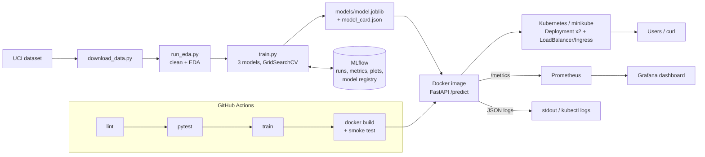

# Heart Disease Risk Prediction - End-to-End MLOps

Predicts the presence of heart disease from patient health data (UCI Heart Disease,
Cleveland subset) and serves the model as a monitored, containerised API on Kubernetes.

**Repository:** `<add your GitHub URL>`  **Demo video:** `<add link>`

## Architecture


## Project layout
```
data/                 download script, raw/ and processed/ data
src/heart_mlops/      package: config, data, features, plots, train, predict, api
scripts/              run_eda, train, predict, smoke_test, send_requests, deploy_minikube.sh
tests/                pytest unit tests (data, features, model, API)
models/               model.joblib + model_card.json (created by training)
reports/              figures, EDA summary, model comparison, final report
k8s/                  namespace, deployment, service (LoadBalancer), ingress, kustomization
monitoring/           docker-compose: API + Prometheus + Grafana (provisioned dashboard)
.github/workflows/    ci.yml - lint -> test -> train -> docker smoke test
screenshots/          evidence for the report
Dockerfile, Makefile, requirements*.txt, environment.yml, sample_request.json
```

## 1. Setup
```bash
python -m venv .venv && source .venv/bin/activate   # Windows: .venv\Scripts\activate
pip install -r requirements-dev.txt                 # runtime + test/lint tools
```
`requirements.txt` = everything to run the pipeline and API; `requirements-api.txt` = slim
set for the container; `environment.yml` = Conda alternative. Every step has a `make` shortcut (`make help`).

## 2. Data & EDA
```bash
python data/download_data.py     # make data
python scripts/run_eda.py        # make eda
```
| Issue | Treatment | Why |
|---|---|---|
| `?` markers in `ca`, `thal` | read as missing, filled with most frequent value | few rows, categorical |
| Target `num` is 0-4 severity | `target = 1 if num > 0` | assignment asks presence/absence |
| Duplicate rows | dropped | avoid leakage between CV folds |
| Implausible values (e.g. BP < 70) | set to missing, then imputed | entry errors, keep the row |
| Model-time imputation | redone inside the sklearn pipeline | no leakage from validation folds |

## 3. Features, models & MLflow tracking
```bash
python scripts/train.py          # make train   (~3-6 min)
make mlflow-ui                   # http://localhost:5000 -> experiment "heart-disease-risk"
```
| Feature | Treatment |
|---|---|
| age, trestbps, chol, thalach, oldpeak, ca | median impute -> standard scale |
| sex, fbs, exang | most-frequent impute |
| cp, restecg, slope, thal | most-frequent impute -> one-hot |
| **hr_pct_of_max** (new) | thalach / (220 - age) |
| **bp_stage2** (new) | resting BP >= 140 mm Hg |

* Stratified 80/20 hold-out; test set never used for tuning or selection.
* Logistic Regression, Random Forest, Gradient Boosting; `GridSearchCV`, stratified 5-fold, ROC-AUC.
* Metrics: accuracy, precision, recall, F1, ROC-AUC (CV mean +/- std and hold-out).
* Winner = best mean CV ROC-AUC, refit on all data.
* MLflow: parent run -> run per model family -> run per grid trial; plots, grid CSVs, model
  card and the MLflow model (registered as `heart-disease-classifier`).

## 4. Packaging & reproducibility
* `models/model.joblib` - the **whole** pipeline (feature engineering + preprocessing + classifier).
* `models/model_card.json` - params, metrics, data SHA-256, Python & scikit-learn versions.
* Fixed seeds; the Docker build installs the exact scikit-learn version from the model card.
```bash
python scripts/predict.py --input sample_request.json      # make predict
```

## 5. Tests & CI/CD
```bash
make lint && make test
```
`.github/workflows/ci.yml` runs on every push / PR: **lint -> unit tests -> train -> Docker build +
smoke test**. Each job uploads artifacts (JUnit + coverage, model, reports + MLflow DB, container
logs). Any failure stops the pipeline.

## 6. Container
```bash
make docker-build && make docker-run
python scripts/smoke_test.py                                # make smoke
curl -X POST localhost:8000/predict -H "Content-Type: application/json" -d @sample_request.json
```
Endpoints: `GET /health`, `GET /model-info`, `POST /predict`, `POST /predict/batch`, `GET /metrics`,
interactive docs at `/docs`. Example response:
```json
{"request_id": "3f9c2a1b7d4e", "prediction": 1, "label": "heart disease",
 "probability_disease": 0.87, "confidence": 0.87, "risk_band": "high",
 "model_name": "<selected model>", "model_version": "<training timestamp>"}
```

## 7. Kubernetes (minikube)
```bash
bash scripts/deploy_minikube.sh          # build, load image, kubectl apply -k k8s/
minikube tunnel                          # in a 2nd terminal, keep open
kubectl -n heart-risk get svc heart-risk-api          # EXTERNAL-IP
python scripts/smoke_test.py --url http://<EXTERNAL-IP>
```
Deployment: 2 replicas, rolling update, readiness/liveness probes on `/health`, resource
limits, non-root, Prometheus scrape annotations. Service: `LoadBalancer`. Optional Ingress
host `heart-risk.local`.

## 8. Monitoring & logging
```bash
make monitor-up                          # API :8000, Prometheus :9090, Grafana :3000
make traffic                             # 300 requests incl. ~5% invalid
```
* Every request is logged as one JSON line (request id, method, path, status, latency).
* Prometheus metrics: `api_requests_total`, `api_request_latency_seconds`,
  `model_predictions_total`, `model_probability_disease`, `model_loaded`.
* Grafana dashboard **Heart Risk API** is provisioned automatically.
